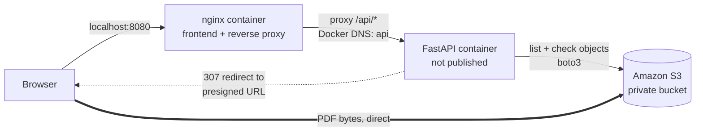

# PDF Portal

A web app for reading and downloading PDF files stored in **Amazon S3**, built step by step as a hands-on **DevOps learning project**: from a local Python API to containers, infrastructure as code and automated deployment on AWS.

The S3 bucket stays **private**. The API hands out short-lived **presigned URLs**, so PDFs travel straight from S3 to the browser and never through the server.

## Architecture



1. The browser loads the frontend from **nginx** on `localhost:8080`.
2. The frontend calls `GET /api/pdfs` on the same origin; nginx proxies it to the API container, which lists the PDFs in S3 (paginated). Same origin means no CORS is needed.
3. Clicking **Read** or **Download** calls `GET /api/pdfs/{name}`; the API checks the file exists and answers **307** with a presigned S3 URL (valid for 5 minutes).
4. The browser fetches the PDF directly from S3, shown inline or downloaded.

The API container is only reachable inside the Docker network, never directly from the host.

## Tech stack

| Area | In use | Coming next |
|---|---|---|
| Backend | Python, FastAPI, Uvicorn, boto3 | Automated tests (pytest), linting (ruff) |
| Frontend | HTML, CSS, JavaScript, served by nginx | |
| Cloud | AWS S3, IAM, AWS CLI | ECS Fargate, ECR, ALB, CloudFront, CloudWatch |
| Containers | Docker (slim, non-root image), Docker Compose, nginx reverse proxy, health checks | |
| Infrastructure as Code | – | Terraform |
| CI/CD | Git, GitHub pull requests | GitHub Actions with OIDC |
| Tooling | Bash scripts (strict mode) | |

## API

| Method | Path | Response |
|---|---|---|
| `GET` | `/health` | `200 {"status":"ok"}`, used by health checks |
| `GET` | `/api/pdfs` | `200` JSON list of PDFs with size and last-modified date |
| `GET` | `/api/pdfs/{name}` | `307` redirect to a presigned S3 URL (`?download=true` downloads instead of displaying); `404` if missing; `400` for invalid names |

Interactive API docs are available at `/docs` while the API runs.

## Project structure

```
pdf-portal/
├── compose.yaml               # the whole local stack: web + api
├── backend/
│   ├── main.py                # FastAPI app
│   ├── requirements.txt       # pinned production dependencies
│   ├── requirements-dev.txt   # local-only extras
│   ├── Dockerfile             # slim, non-root image
│   ├── .dockerignore
│   └── .env.example           # configuration template
├── frontend/
│   ├── index.html · styles.css · app.js
│   ├── config.js              # API address when run without Docker
│   ├── config.docker.js       # same-origin config, copied into the image as config.js
│   ├── nginx.conf             # static files + /api/ reverse proxy + /health
│   └── Dockerfile             # nginx image with the frontend
├── sample-pdfs/               # local test files (not committed)
└── scripts/
    ├── check-tools.sh         # verifies tools and AWS login
    └── dev-up.sh              # starts the stack with temporary AWS credentials
```

## Configuration

All settings come from environment variables, so the same code runs locally, in Docker and on AWS.

| Variable | Required | Default | Purpose |
|---|---|---|---|
| `S3_BUCKET` | yes | – | Bucket holding the PDFs |
| `AWS_REGION` | yes | – | Bucket region, e.g. `eu-north-1` |
| `S3_PREFIX` | no | `pdfs/` | Key prefix of the PDFs |
| `URL_EXPIRY_SECONDS` | no | `300` | Lifetime of presigned URLs |
| `CORS_ORIGINS` | no | empty | Comma-separated origins allowed to call the API. Not needed with Docker Compose (same origin) |

AWS credentials are **never** stored in the code or in `.env`. Locally they come from `aws login` (temporary credentials); on AWS they will come from an IAM role.

## Run locally

**Prerequisites:** Docker Desktop, AWS CLI v2 with `aws login`, and an S3 bucket with PDFs under `pdfs/`.

```bash
./scripts/check-tools.sh                  # check tools and AWS login
cp backend/.env.example backend/.env      # then set S3_BUCKET and AWS_REGION
./scripts/dev-up.sh                       # build and start the stack
```
Open http://localhost:8080. Stop with Ctrl + C, then run `docker compose down`.

`dev-up.sh` fetches temporary AWS credentials and passes them only to Docker Compose, so they never stay in your terminal.

Useful commands while it runs: `docker compose ps` (status and health), `docker compose logs -f api` (follow the API logs).

## Security decisions

- **Private bucket** with Block Public Access; files are only reachable through short-lived presigned URLs.
- **Least privilege:** the API only needs `s3:ListBucket` and `s3:GetObject` on one bucket.
- **Input validation:** file names containing `/` or `\`, or not ending in `.pdf`, are rejected (path traversal protection).
- **XSS protection:** the frontend inserts data with `textContent`, never `innerHTML`.
- **No secrets in Git or images:** `.env` is ignored by both `.gitignore` and `.dockerignore`.
- **Non-root API container** built from a slim base image.
- **API not published:** only nginx is reachable from the host; the API sits inside the Docker network.
- **Fail fast:** the API refuses to start without its required settings.

## Roadmap

- [x] Bash tooling and Git feature-branch workflow
- [x] FastAPI backend
- [x] S3 storage with presigned URL redirects
- [x] Static frontend with configurable CORS
- [x] Docker image for the API
- [x] Docker Compose with an nginx reverse proxy
- [ ] Automated tests and linting
- [ ] Infrastructure as code with Terraform
- [ ] CI/CD with GitHub Actions (OIDC, no stored keys)
- [ ] Deployment to AWS ECS Fargate behind a load balancer
- [ ] Monitoring and alarms with CloudWatch
- [ ] CloudFront CDN and HTTPS

## Lessons learned

- **New S3 buckets and DNS propagation:** presigned URLs on the global endpoint failed for a freshly created bucket; using the regional endpoint (`s3.eu-north-1.amazonaws.com`) fixed it permanently.
- **The credential provider chain:** stale credentials in environment variables override a fresh `aws login`, which is a strong argument for IAM roles in production.
- **Layer caching:** copying `requirements.txt` before the code keeps rebuilds down to seconds.
- **Compose reads the whole file for every command:** a fail-fast `${VAR:?}` on credentials broke even `docker compose ps`, so the check moved into the start script and the variables became pass-through.
- **Restart policies ignore manual stops:** `docker compose kill` is respected as intentional; only a process that exits by itself is restarted.
